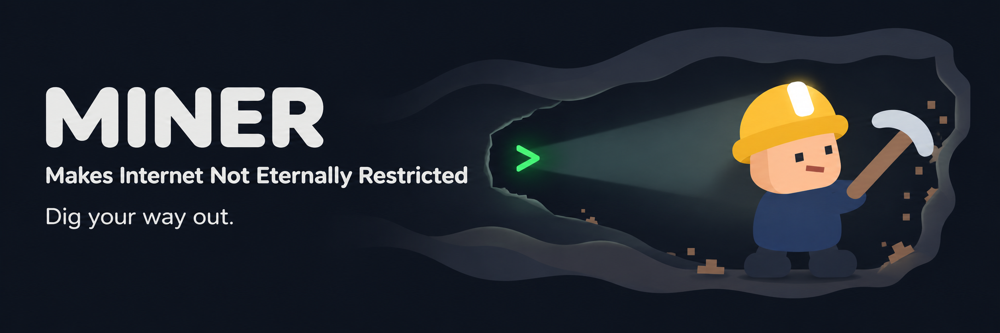
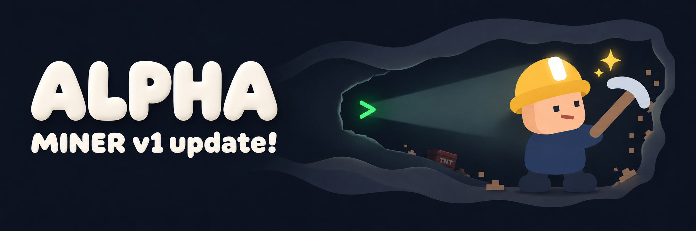
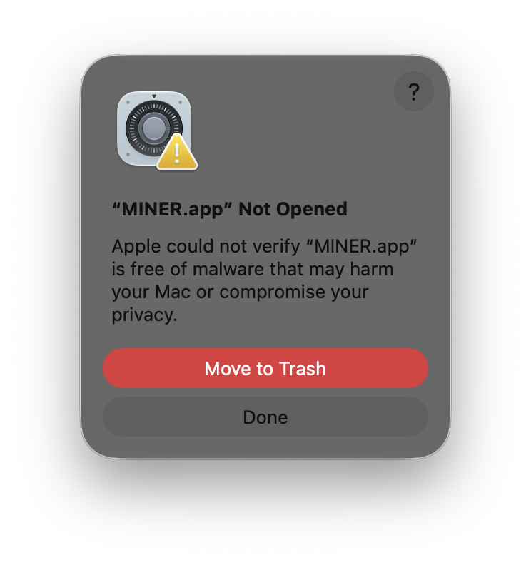
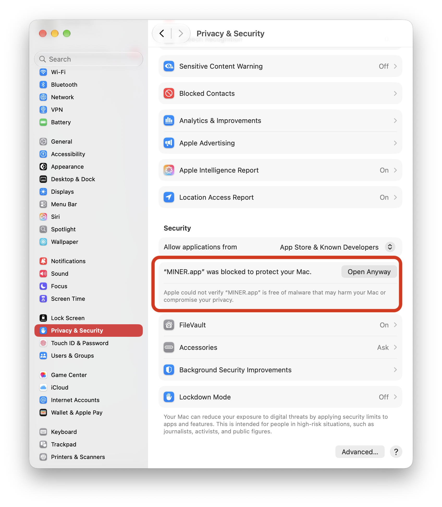
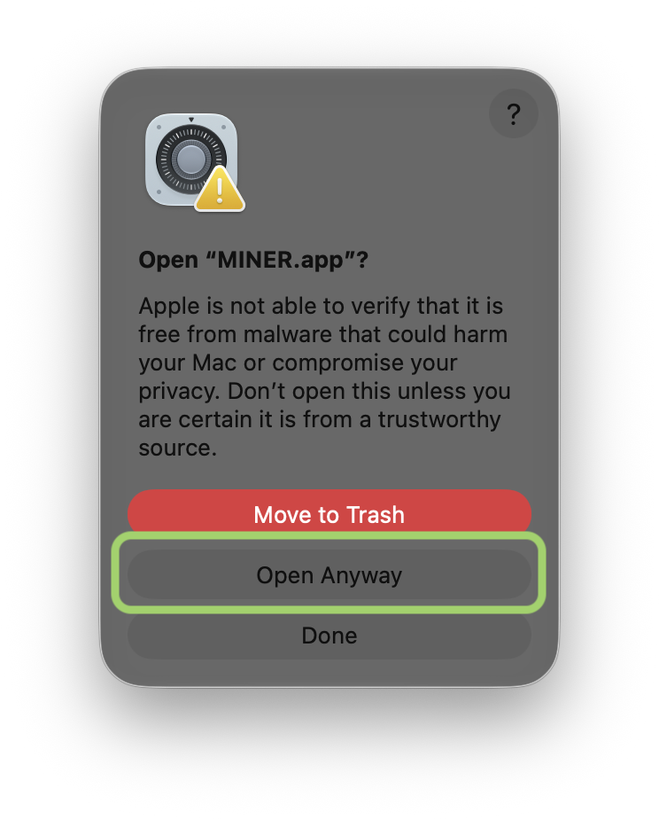
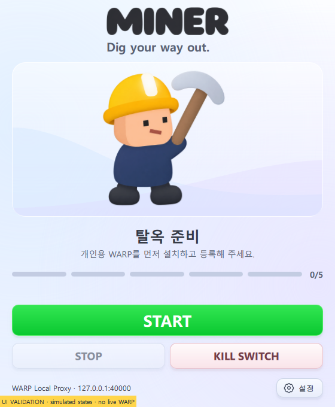
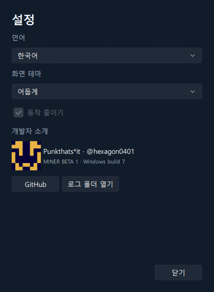
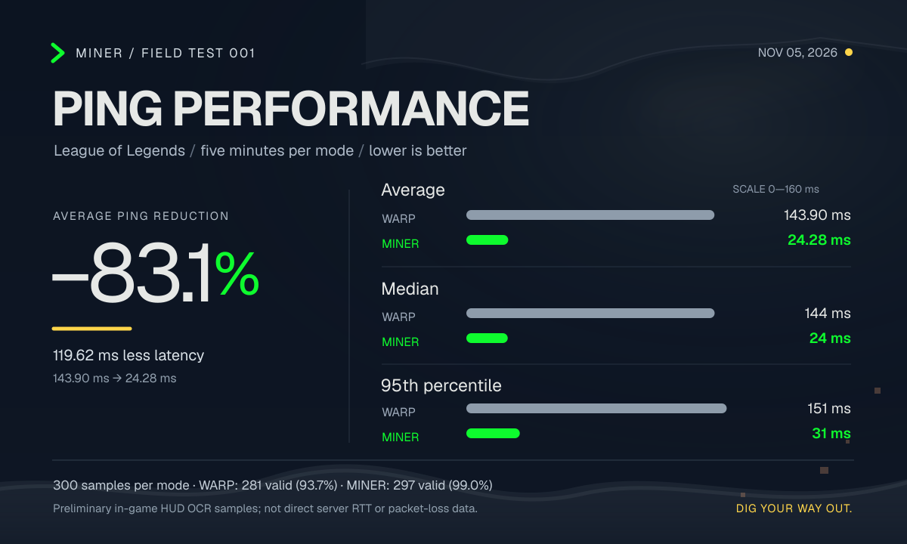

<div align="center">



# MINER

**Dig your way out. — 학교 네트워크의 벽을 넘어.**

클라이언트는 WARP로, 게임은 직접 연결로.
학교 네트워크의 접속 제한과 게임 지연 문제에서 출발한 분리 라우팅 앱입니다.


[다운로드](#다운로드) · [설치](#설치) · [사용 방법](#사용-방법) · [성능](#성능-performance) · [개발 안내](#개발-안내)

</div>

---

## 개요

**ALPHA는 MINER의 큰 버전 코드명이며, 개발 단계 표시가 아닙니다.** `v1`은 ALPHA 세대의 첫 릴리스입니다. 현재는 WARP Local Proxy와 분리 라우팅으로 클라이언트 접속 제한을 우회하고 게임 지연을 줄이는 데 초점을 둡니다. 스쿨넷의 제한을 더 폭넓게 극복하는 것이 장기 목표이며, 향후 대규모 구현 세대가 바뀌면 새로운 코드명을 사용할 계획입니다.

학교에서는 리그 오브 레전드(LoL)를 비롯한 게임의 접속과 플레이를 네트워크에서 제한합니다. MINER는 이러한 제한을 기술적으로 파훼하고, 대한민국 교육청을 통해 학교에 제공되는 **스쿨넷 환경의 게임 접속 차단을 회피·돌파하는 것**을 목표로 시작한 프로젝트입니다.

MINER는 **클라이언트 통신은 WARP로, 게임 플레이 통신은 직접 연결로** 나눕니다. **접속 가능성과 함께 게임 지연 및 컴퓨터 성능에 주는 영향을 줄이는 것**이 개발의 핵심입니다. 연결·종료에 필요한 설정 전환도 앱에서 처리합니다.

| 통신 | 연결 경로 |
| :-- | :-- |
| Riot·LoL 클라이언트 및 웹 Helper의 TCP | WARP Local Proxy |
| 게임 실행 파일의 통신 | 직접 연결 |
| 일반 DNS · 포트 53 | WARP를 통한 암호화 DNS |

현재는 개인용 Cloudflare WARP를 기반으로 macOS와 Windows x64 버전을 개발합니다. 게임 통신 자체가 차단된 환경에서는 직접 연결이 작동하지 않을 수 있습니다. 전국 모든 학교에서의 작동이나 모든 지연·연결 끊김의 해결을 보장하지 않습니다.

<details>
<summary><strong>개발 배경 · 왜 WARP와 분리 라우팅인가요?</strong></summary>

처음에는 모바일 데이터와 핫스팟으로 학교망을 벗어나거나, VPN으로 통신 경로를 우회하는 방법을 살펴봤습니다. 하지만 모바일 데이터는 다운로드 용량과 핫스팟 한도, 요금 부담이 있었고, 일부 VPN은 비용과 지연 시간, 연결 안정성 측면에서 게임용으로 사용하기에 아쉬움이 있었습니다.

그 과정에서 찾은 돌파구가 **Cloudflare WARP**였습니다. 개인용 WARP는 무료로 사용할 수 있었고, 저희가 시험한 환경에서는 차단된 게임 클라이언트와 웹사이트에 접속하면서도 비교적 안정적인 속도를 보여 주었습니다. 다만 접속 제한을 넘는 것과 쾌적하게 게임을 플레이하는 것은 별개의 문제였습니다.

클라이언트 로그인과 다운로드는 정상적으로 진행되더라도, 게임 중 지연이 급격히 커지거나 WARP 연결이 불안정해지는 경우가 있었습니다. 재연결 과정에서 게임 접속이 끊기기도 했고, 이를 피하려고 WARP를 끄면 게임 종료 후 클라이언트에 복귀할 때 다시 WARP를 켜고 클라이언트까지 재실행해야 했습니다. **단순히 접속만 되는 것으로는 충분하지 않았습니다.**

</details>

## 다운로드

[](https://github.com/hexagon0401/MINER/releases/tag/miner-alpha-v1.0.1)

**MINER ALPHA v1.0.1** · [최신 정식 릴리스 보기](https://github.com/hexagon0401/MINER/releases/tag/miner-alpha-v1.0.1)

[](https://github.com/hexagon0401/MINER/releases/download/miner-alpha-v1.0.1/MINER-ALPHA-v1.0.1-macOS-AppleSilicon.dmg)
[](https://github.com/hexagon0401/MINER/releases/download/miner-alpha-v1.0.1/MINER-ALPHA-v1.0.1-macOS-Intel.dmg)
[](https://github.com/hexagon0401/MINER/releases/download/miner-alpha-v1.0.1/MINER-ALPHA-v1.0.1-Windows-x64-Setup.exe)

| 컴퓨터 | 설치 파일 | 구성 |
| :-- | :-- | :-- |
| Mac · Apple Silicon (M 시리즈) | [DMG 다운로드](https://github.com/hexagon0401/MINER/releases/download/miner-alpha-v1.0.1/MINER-ALPHA-v1.0.1-macOS-AppleSilicon.dmg) | macOS 기본 UI · SwiftUI |
| Mac · Intel | [DMG 다운로드](https://github.com/hexagon0401/MINER/releases/download/miner-alpha-v1.0.1/MINER-ALPHA-v1.0.1-macOS-Intel.dmg) | macOS 기본 UI · SwiftUI |
| Windows · x64 | [EXE 다운로드](https://github.com/hexagon0401/MINER/releases/download/miner-alpha-v1.0.1/MINER-ALPHA-v1.0.1-Windows-x64-Setup.exe) | Windows Pearl White · A/B 버튼 |

기존 v1의 네트워크·UI를 유지하고 기본 아이콘을 적용한 **ALPHA v1.0.1 정식 릴리스**입니다. 베타 빌드는 BETA 아이콘을 사용합니다. 플랫폼별로 **별도 설치 파일**을 제공합니다. Mac과 Windows는 각각의 UI를 유지합니다. [체크섬](https://github.com/hexagon0401/MINER/releases/download/miner-alpha-v1.0.1/SHA256SUMS.txt) · [플랫폼별 버전·출처](https://github.com/hexagon0401/MINER/releases/download/miner-alpha-v1.0.1/release-manifest.json) · [Windows 소스](https://github.com/hexagon0401/MINER/tree/windows-beta1)

| 구분 | 현재 상태 |
| :-- | :-- |
| 베타 1 유지 보수 | [`beta1-maintenance`](https://github.com/hexagon0401/MINER/tree/beta1-maintenance)에서 개발 |
| 베타 2 | 학교 현황·진단·제보 기능의 **소스만 보관**. 배포용 DMG에 미포함 |
| 공유 제보 서버 | 미개방 |
| Homebrew | 자체 tap으로 설치 · 정식 릴리스의 cask 자동 갱신 |

## 설치

### macOS

#### Homebrew로 설치

[Homebrew](https://brew.sh/ko/)가 설치된 Mac에서 사용할 수 있습니다. 개인용 [Cloudflare WARP](https://one.one.one.one/)는 별도로 설치하고 최초 등록을 마쳐 주세요.

```bash
brew tap hexagon0401/miner https://github.com/hexagon0401/MINER.git
brew trust --cask hexagon0401/miner/miner
brew install --cask miner
```

첫 번째 명령은 MINER 저장소를 Homebrew의 앱 배포 경로인 **tap**으로 등록합니다. 최초 등록 시 저장소 URL을 함께 입력해 주세요. 두 번째 명령은 외부 tap의 **MINER cask를 신뢰 대상으로 등록**합니다. 등록 후 세 번째 명령으로 설치합니다. Apple Silicon·Intel은 자동으로 구분합니다. `brew install --cask hexagon0401/miner/miner`는 같은 앱을 배포 경로까지 지정한 표기이며, `--cask`는 macOS 앱 설치임을 명시합니다.

새 정식 릴리스가 나오면 검증 후 cask가 자동 갱신됩니다. MINER에서 **중지 → WARP 복귀 확인 → 앱 종료**를 마친 뒤 업데이트합니다.

```bash
brew update
brew upgrade --cask miner
```

DMG로 직접 설치한 MINER가 이미 있으면 Homebrew 설치가 중단될 수 있습니다. 앱을 중지·종료한 뒤 기존 설치와 사용자 데이터를 확인하고 전환해 주세요. Homebrew로 설치해도 아래의 최초 실행 허용 절차는 동일하게 적용됩니다. Mac에서의 Homebrew 설치·업데이트·제거 실기 검증은 아직 진행 전입니다.

#### DMG로 설치

1. 개인용 [Cloudflare WARP](https://one.one.one.one/)를 설치하고 최초 등록을 마칩니다.
2. 위에서 Mac의 칩에 맞는 **Apple Silicon 또는 Intel DMG**를 다운로드해 엽니다.
3. 왼쪽의 `MINER.app`을 오른쪽의 **Applications(응용 프로그램)** 폴더로 드래그합니다.
4. 응용 프로그램 폴더에서 `MINER.app`을 실행합니다.

> [!IMPORTANT]
> 현재 macOS 배포본은 **ad-hoc 서명이며 Apple 공증이 없습니다.** 처음 실행할 때 차단되면 아래 안내를 펼쳐 주세요.

<details>
<summary><strong>처음 실행할 때 차단되나요? · Open Anyway 안내와 스크린샷</strong></summary>


현재 배포본은 **ad-hoc 서명이며 Apple 공증이 적용되지 않았습니다.** 처음 실행하면 아래 순서로 앱 실행을 허용해야 할 수 있습니다. MINER 공식 릴리스에서 받은 파일인지 확인한 뒤 진행해 주세요.

**1. 실행 차단 창 닫기**

`“MINER.app” Not Opened`(MINER.app을 열지 못함) 창이 나타나면 **Done(완료)**을 누릅니다. **Move to Trash(휴지통으로 이동)**는 누르지 않습니다.



**2. 시스템 설정에서 실행 허용**

**시스템 설정 → 개인정보 보호 및 보안 → 보안**으로 이동합니다. `“MINER.app” was blocked to protect your Mac` 안내 옆의 **Open Anyway(확인 없이 열기)**를 누릅니다. 항목이 보이지 않으면 응용 프로그램 폴더에서 MINER를 한 번 실행한 뒤 설정을 다시 확인합니다.



**3. 최종 확인 창에서도 실행 허용**

`Open “MINER.app”?` 확인 창이 나타나면 여기서도 **Open Anyway(확인 없이 열기)**를 누릅니다. macOS에서 암호나 Touch ID 인증을 요구하면 인증합니다. 이후 MINER 창이 열립니다.



macOS 버전과 표시 언어에 따라 버튼 이름이나 화면 구성은 조금 다를 수 있습니다. `앱이 손상되어 열 수 없습니다`처럼 다른 오류가 표시되는 경우에는 이 안내와 다른 문제일 수 있으므로 오류 문구를 확인해 주세요.

</details>

### Windows x64

1. 개인용 Cloudflare WARP를 설치하고 최초 등록을 마칩니다.
2. 위 **Windows EXE**로 설치한 뒤 MINER를 실행합니다. 관리자 권한(UAC)이 필요합니다.
3. **START**로 연결하고 **STOP**으로 엔진 정리와 WARP 복귀를 확인합니다. **KILL SWITCH**는 엔진 정리 후 WARP 연결을 해제하며 일반 인터넷은 유지합니다. 설정은 **Ctrl+,**로 열고 버튼 스타일에서 A안/B안을 전환할 수 있습니다.
4. 제거하려면 MINER에서 중지·종료한 뒤 Windows의 **설치된 앱**에서 MINER를 제거합니다. 사용자 설정과 로그, WARP는 보존합니다.

> [!NOTE]
> Windows 화면은 **Pearl White A안·Qt Quick RHI·D3D11**을 사용하고 한국어는 맑은 고딕, 영어는 Segoe UI 계열을 우선합니다. Mac은 SwiftUI를 유지하며 플랫폼별 창·설정 조작을 따릅니다. Windows 11 x64를 대상으로 개발하지만 자동 검증은 **Windows Server 2025**에서 수행했습니다. 설치·재설치·제거, 실제 TUN 생성·종료, 프로세스 정리, 화면 배율 100~200%를 확인했습니다. **실제 Windows 11·WARP 연결·학교망·LoL·Vanguard는 미검증**이며, 실행 파일은 Authenticode 미서명입니다.

<details>
<summary><strong>Windows 실행 화면과 애니메이션 보기</strong></summary>

기본은 **A안 플로팅 버튼**입니다. 설정의 **버튼 스타일**에서 B안 일체형 컨트롤로 전환할 수 있습니다. 새 에셋 명세에 따라 캐릭터는 정적이며, 학교·땅굴·채굴 효과는 표시하지 않습니다.

아래는 패키징한 EXE의 **UI 검증 화면**입니다. 연결 상태는 검사용 주입 값이며 실제 WARP나 게임 접속 성공을 의미하지 않습니다.




[상태 전환 GIF](https://github.com/hexagon0401/MINER/releases/download/v5.0.0-beta.1.1-windows.8/MINER-v5.0.0-beta.1.1-windows.8-Windows-x64-Preview.gif) · [B안 미리보기](https://github.com/hexagon0401/MINER/releases/download/v5.0.0-beta.1.1-windows.8/MINER-v5.0.0-beta.1.1-windows.8-Windows-x64-flush.png) · [전체 스크린샷 ZIP](https://github.com/hexagon0401/MINER/releases/download/v5.0.0-beta.1.1-windows.8/MINER-v5.0.0-beta.1.1-windows.8-Windows-x64-Screenshots.zip) · [Mac 대비 변경점](https://github.com/hexagon0401/MINER/blob/windows-beta1/v5/windows/README.md)

</details>

## 사용 방법

1. 기존 SchoolNet 또는 MINER가 실행 중이면 먼저 중지하고 종료합니다.
2. MINER에서 **시작**을 누릅니다. 앱이 WARP CLI로 Local Proxy 모드를 준비하고 `127.0.0.1:40000` 연결을 확인한 뒤 분리 라우팅을 시작합니다.
3. 클라이언트의 TCP 통신은 WARP 경로로, 게임 실행 파일과 나머지 트래픽은 직접 경로로 보냅니다. 진행 막대는 실제 백엔드 상태에 따라 표시됩니다.
4. **중지** 또는 앱 종료 시 엔진을 정리하고 WARP를 **UDP — Traffic and DNS** 모드로 복귀시킵니다. 실패하면 앱에 표시되는 오류를 확인합니다.
5. **⌘,**로 설정을 열어 한국어·영어 변경, 개발자 소개, 제거 기능을 사용할 수 있습니다.

## 성능 (Performance)

**첫 번째 리그 오브 레전드 인게임 벤치마크에서 MINER의 평균 핑은 WARP 단독 실행보다 83.1% 낮게 측정됐습니다.** 각각 5분간 기록한 결과, 평균 핑은 **WARP 143.90ms → MINER 24.28ms**로 **119.62ms 감소**했습니다. 수치가 낮을수록 지연시간이 짧습니다.



| 인게임 핑 지표 | WARP 단독 | MINER | 변화 |
| :-- | --: | --: | --: |
| **평균** | **143.90ms** | **24.28ms** | **−83.1% (−119.62ms)** |
| 중앙값 | 144ms | 24ms | −120ms |
| P95 (95백분위 지연시간) | 151ms | 31ms | −120ms (−79.5%) |
| 관측된 최대 핑 | 158ms | 42ms | −116ms |
| 유효 OCR 표본 | 281/300 (93.7%) | 297/300 (99.0%) | — |

### 측정 방법

- **측정일:** 2026년 11월 5일
- **환경:** macOS에서 실행한 리그 오브 레전드 게임 화면
- **비교:** WARP 단독 / MINER 각각 5분, 1회씩 순차 측정
- **수집:** 1초마다 게임 화면을 캡처해 Apple Vision OCR로 우측 상단 인게임 핑을 판독
- **통계:** 인식된 값만으로 평균·중앙값·P95 계산. OCR 인식 실패는 `0ms`로 처리하지 않음

> [!NOTE]
> 이는 **게임 HUD에 표시된 핑**을 측정한 결과이며, 실제 서버에 직접 보낸 패킷의 RTT 측정이 아닙니다. 각 모드 1회씩 순차 측정한 **예비 결과**로, 네트워크 상태·시간·라우팅 등에 따라 달라질 수 있습니다. OCR 인식률은 패킷 손실률이 아닙니다. WARP의 최저 기록 14ms는 OCR 오인식 가능성이 있으므로 최저 핑 성능을 주장하는 근거로 사용하지 않았습니다.

**Dig your way out.**

## 현재 검증 범위

베타 1.1은 자동 테스트 59개, macOS 네이티브 UI 검사 22개, DMG 설치 복사 후 앱 서명 무결성 검증을 통과했습니다. 학교망에서의 실제 게임 지연·프레임·클라이언트 영상 재생과 WARP 복귀는 사용자 환경에서 별도로 확인해야 합니다. 프록시 HTTPS 진단 성공이 실제 게임 플레이나 특정 학교에서의 작동을 증명하지는 않습니다.

베타 2 소스의 초록 깃발은 과거 성공 기록이 있음을, 빨강 깃발은 성공이 아직 확인되지 않았음을 뜻합니다. 내 기기의 기록과 운영자가 승인한 공유 기록은 구분하며, 전국 학교 통계와 공유 제보 서비스는 현재 제공하지 않습니다.

## 개발 안내

[버전·beta·브랜치 보관함](archive/README.md) · [전체 파일·커밋 목록](archive/inventory.json)

| 문서 | 내용 |
| :-- | :-- |
| [Windows 기술 안내](https://github.com/hexagon0401/MINER/blob/windows-beta1/v5/windows/README.md) | Windows 베타 1 설치·복구·현지화 변경점 |
| [v5 기술 안내](v5/README.md) | 설치·연결 구조·CLI 사용법 |
| [학교 데이터·제보 시스템](v5/community/README.md) | 베타 2의 로컬 진단과 제보 구조 |
| [베타 2 인계](v5/docs/BETA2_HANDOFF.md) | 개발 상태와 남은 작업 |
| [Homebrew](packaging/homebrew/README.md) | 배포 준비 |
| [Apple 서명·공증](v5/docs/SIGNING.md) | 인증서와 공증 설정 |
| [Mac 빌드 러너](v5/docs/SELF_HOSTED_MAC.md) | 개인 Mac 러너 준비 |

이전 v1~v4는 개발 이력으로 보존합니다. v5 설치·제거는 WARP나 이전 버전을 삭제하지 않습니다.

## 개발자 프로필

<a href="https://github.com/hexagon0401"></a>

**[Punkthats*it · @hexagon0401](https://github.com/hexagon0401)**
MINER를 개발하고 있습니다. 프로젝트 소식과 소스 코드는 GitHub에서 확인할 수 있습니다.

[](https://github.com/hexagon0401)
