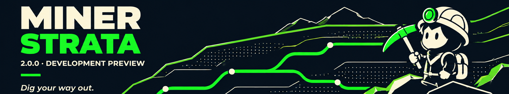
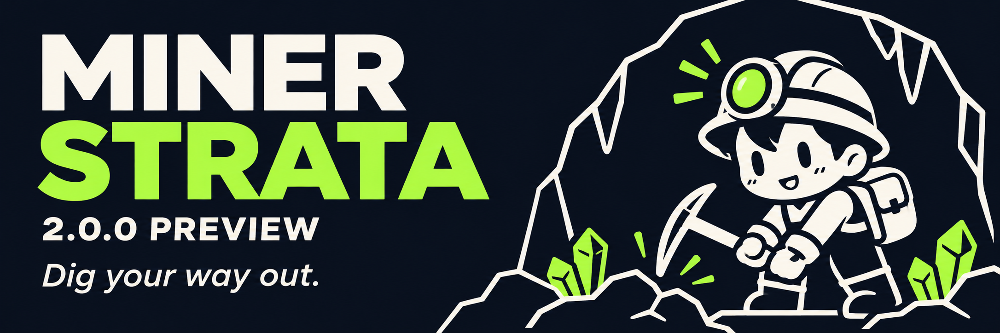
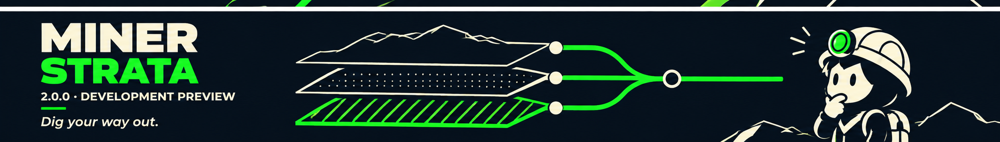

<div align="center">



# MINER STRATA

**Dig your way out.**


**연결 경로는 분리하고, 연결 상태는 지속해서 관리한다.**

</div>

> [!IMPORTANT]
> **STRATA 2.0.0은 개발 기획 단계다. 아직 완성·실기 검증·배포되지 않았다.** 현재 공개 버전은 [MINER ALPHA 1.2.3](https://github.com/hexagon0401/MINER/releases/tag/miner-alpha-v1.2.3)이다. 본 문서는 2.0.0의 README 시안이며 기존 배포 안내를 대체하지 않는다.

---

## STRATA 2.0.0 배너 시안 (ALPHA 출시 배너 계승)



*현재는 개발 프리뷰이며 정식 출시 기념 배너가 아니다. 과거 ALPHA 배너를 삭제하거나 교체하지 않는다.*

## STRATA란?

STRATA는 **지층 / 계층**을 뜻하는 MINER의 차세대 코드명(제안)이다. MINER가 게임 클라이언트 통신과 게임 플레이 통신을 다른 경로로 취급하는 원리를 유지하면서, 서비스 수명·상태 판정·오류 복구를 독립적인 계층으로 강화한다.



## 목표 구조

```text
Native UI / Tray
        │ authenticated local IPC
        ▼
Connection Supervisor (planned)
        ├─ WARP Local Proxy lifetime / health
        ├─ selective routing engine and DNS lease
        ├─ recovery journal / guardian
        └─ independent component status
                 ├─ Supported Riot service TCP → WARP proxy
                 ├─ Game IP traffic              → OS direct path
                 └─ General apps                 → existing OS path
```

현재 ALPHA 1.2.3에서도 지정된 Riot 도메인의 TCP는 가상 IP→선택 TUN→WARP SOCKS 경로, 실제 게임 서버 IP는 기존 경로로 나누려 한다. STRATA의 새 점은 **그 경로를 정확하게 검증하고, UI의 수명과 독립적으로 안전하게 유지·정리하는 연결 서비스**다. 모든 Riot 프로세스 패킷을 이미 완벽하게 구분한다는 뜻이 아니다.

## 개발 목표와 미해결 과제

| 항목 | 현재 1.2.3에서 알려진 문제 | STRATA 목표 |
|:--|:--|:--|
| 통계창 | 게임 종료 후 무한 로딩 사용자 보고 | 실패 요청/경로/세션을 구분한 원인 분석 |
| Service Verify | 단일 Riot 검사 실패가 Mac에서 전체 Error 4/5처럼 표시 | 엔진 상태와 원격 서비스 상태 분리 |
| 지속 연결 | GUI 종료가 정리/복구 흐름과 결합 | 별도 Supervisor + 명시적 Stop |
| DNS | 전역 설정 변경과 복구 저널 의존 | lease 소유권·원복·충돌 관리 |
| 업데이트 | ALPHA 이름/리리스 계약 고정 | 호환 브리지 검증 후 세대 전환 |

학교별 차단 장비·정책·게임 UDP 허용 여부는 현장 관측 없이는 확정할 수 없다. 네트워크 사용 규정과 Riot VPN 정책을 확인해야 한다.

## 개발 단계

`G0 기준선/현장 진단 → G1 상태/오류 판정 → G2 독립 Supervisor → G3 통계창 문제 진단 → G4 선택 경로 정확도 → G5 배포/성능 → G6 실기 검증`

상세 개발 설계와 테스트 매트릭스: [설계](docs/strata/planning/01_BLUEPRINT_KO.md) · [검수](docs/strata/AUDIT_AND_CORRECTIONS_KO.md) · [G0/G1 작업 기록](docs/strata/G0_G1_IMPLEMENTATION_KO.md).

## 다운로드 / 릴리스

현재 **STRATA 릴리스 다운로드 없음**. 실제 사용자는 안정 배포본 [MINER ALPHA v1.2.3](https://github.com/hexagon0401/MINER/releases/tag/miner-alpha-v1.2.3)을 참고한다. STRATA 전환 시 구버전 업데이터/설치 ID/helper/DNS journal의 호환성을 확인하기 전까지 새 릴리스 태그와 다운로드 주소를 만들어 쓰지 않는다.

---

<sub>MINER STRATA 2.0.0 · README design preview · 2026-11-23</sub>
