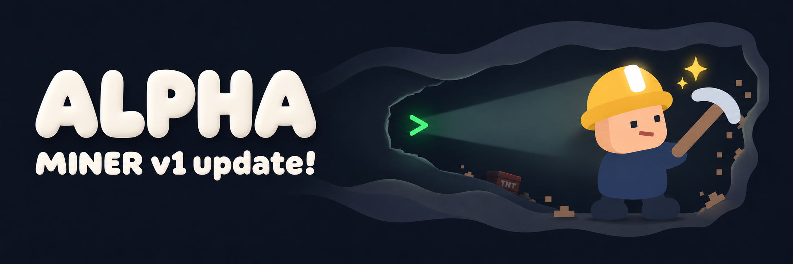

# MINER ALPHA v1

MINER의 첫 번째 ALPHA 정식 릴리스입니다. **ALPHA는 개발 단계(alpha testing)가 아니라 MINER의 큰 버전 코드명**이며, `v1`은 이 코드명에서의 첫 배포를 뜻합니다.

현재 ALPHA 세대는 개인용 Cloudflare WARP의 Local Proxy(기본 `127.0.0.1:40000`)와 분리 라우팅을 사용합니다. 우회가 필요한 클라이언트 통신은 WARP로, 게임 플레이 통신은 직접 연결로 보내 접속 제한을 극복하고 지연을 줄이는 데 초점을 둡니다. 장기적으로는 스쿨넷의 제한을 더 폭넓게 극복하는 것을 목표로 하며, 향후 대규모 구현 세대가 바뀌면 새로운 코드명을 사용할 계획입니다. 전국 모든 학교나 게임에서 작동한다는 보장은 아닙니다.

## 다운로드

| 컴퓨터 | 설치 파일 |
|---|---|
| Mac · Apple Silicon (M 시리즈) | [DMG 다운로드](https://github.com/hexagon0401/MINER/releases/download/miner-alpha-v1/MINER-ALPHA-v1-macOS-AppleSilicon.dmg) |
| Mac · Intel | [DMG 다운로드](https://github.com/hexagon0401/MINER/releases/download/miner-alpha-v1/MINER-ALPHA-v1-macOS-Intel.dmg) |
| Windows · x64 | [EXE 다운로드](https://github.com/hexagon0401/MINER/releases/download/miner-alpha-v1/MINER-ALPHA-v1-Windows-x64-Setup.exe) |

플랫폼별로 별도 설치 파일을 제공합니다. 개인용 Cloudflare WARP는 별도 설치·등록해야 합니다.

- macOS: 기존 SwiftUI 인터페이스와 연결·복귀 동작 유지. DMG에서 MINER.app을 Applications로 옮깁니다.
- Windows: Pearl White UI, 기본 A안 플로팅 버튼과 설정에서 선택하는 B안 일체형 버튼. START는 연결, STOP은 엔진 정리 후 WARP Traffic and DNS 복귀, KILL SWITCH는 엔진 정리 후 WARP 연결 해제입니다. 일반 인터넷은 유지합니다.
- 베타 2 학교·제보 기능은 이번 설치 파일에 포함되지 않습니다.

## 검증과 배포 정보

검증된 현재 플랫폼별 바이너리를 변경 없이 정식 릴리스로 승격했습니다. 파일명과 릴리스 설명을 ALPHA v1으로 정리했으며, 기존 앱 내부 빌드 번호(macOS `5.0.0-beta.1.1`, Windows `5.0.0-beta.1.1-windows.8`)는 추적용으로 유지합니다. 원본 출처와 해시는 `release-manifest.json`, 검사 결과는 각 `.verification.json`, 다운로드 무결성은 `SHA256SUMS.txt`에서 확인할 수 있습니다.

macOS 양쪽 아키텍처는 네이티브 UI·DMG 설치 복사 후 서명 무결성 검사를 통과했습니다. Windows는 TUN 생성·종료, UI, 설치·재설치·제거와 화면 배율 100~200%를 CI에서 확인했습니다.

현재 macOS 빌드는 ad-hoc 서명·미공증이며 Windows EXE는 Authenticode 미서명입니다. 실제 Windows 11·학교망·게임·Vanguard 환경과 GPU 성능은 미검증입니다. 정식 릴리스 게시가 이러한 검증 범위를 확대하거나 Apple/Microsoft 인증을 뜻하지는 않습니다.
